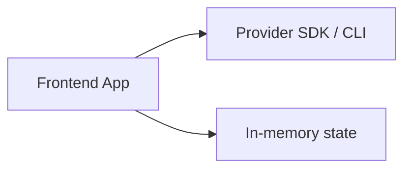
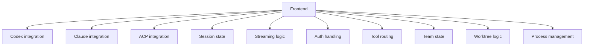
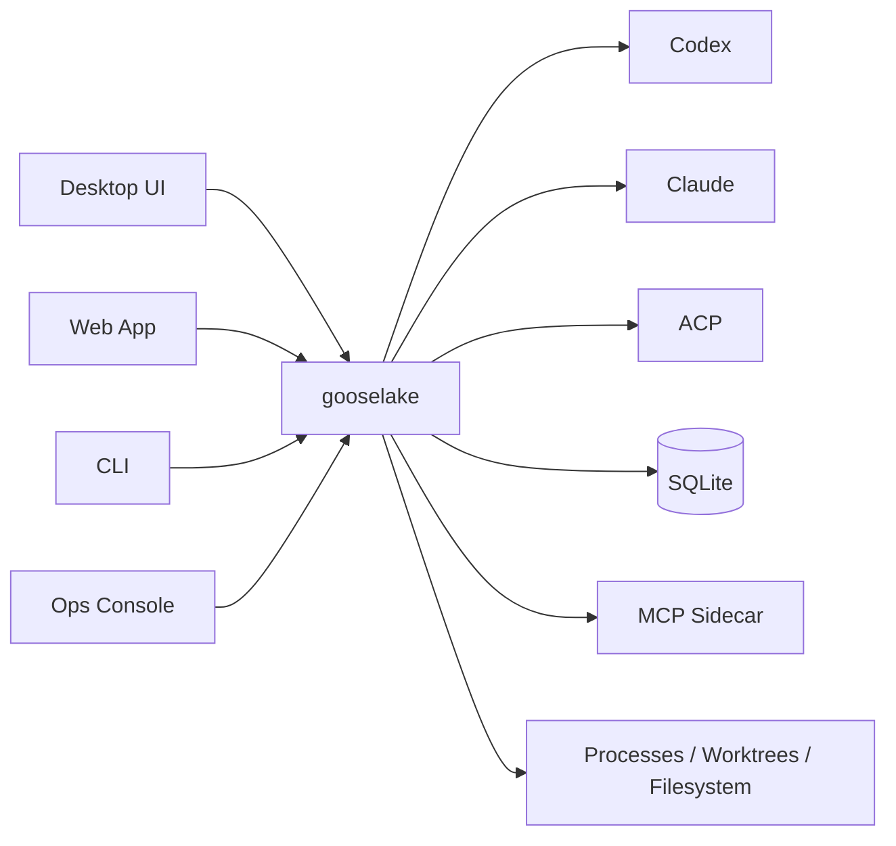
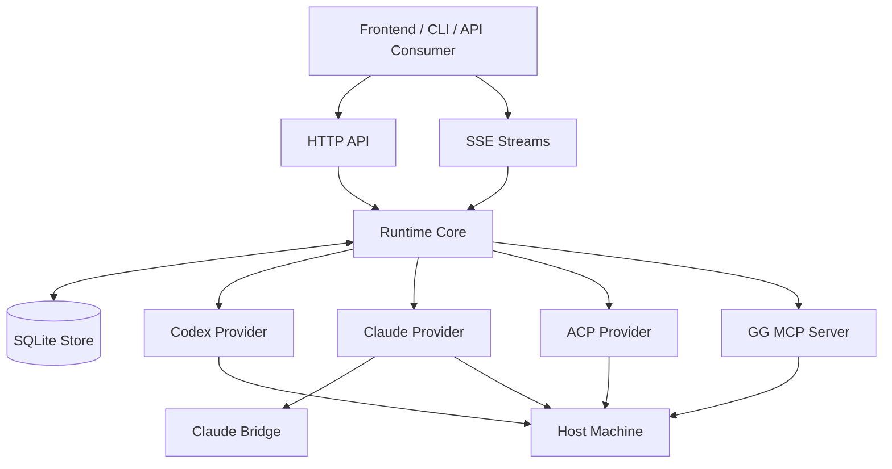
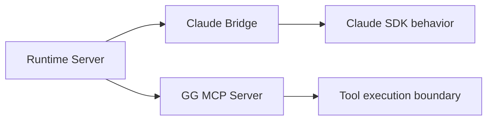
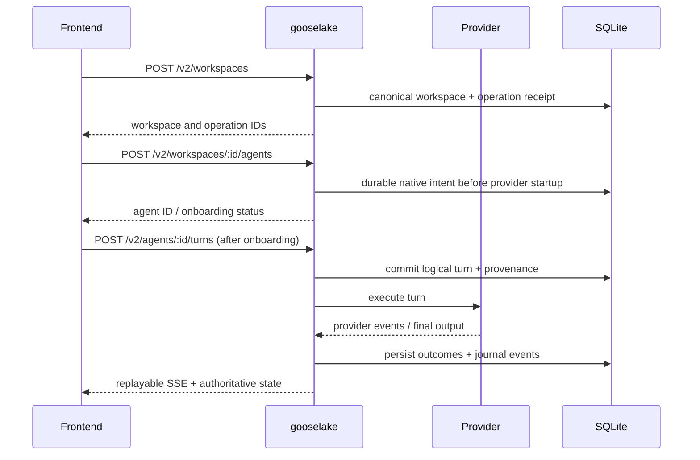

# gooselake

gooselake is an air traffic control tower for machine agents, not a chat widget with ambition problems.

That line is a little rude, but it is also the cleanest way to explain the repo.

Most agent products start with the wrong center of gravity: the UI.

You wire a provider into a frontend, stream a few tokens, add a tool or two, and it feels like progress, at least for a while.

Most agent products start the same way:

- wire a model provider into a frontend
- stream some tokens
- add a few tools
- bolt on persistence later

That works right up until you want the agent to stop being a demo and start being a system.

The moment an agent has to do real work on a real machine, the problem changes completely.

Now you are not building "chat."

You are building a runtime.

You do not just need "chat with tools." You need:

- durable sessions
- reconnectable event streams
- machine-local auth
- processes that outlive a browser tab
- worktrees and filesystem actions
- team communication
- provider-specific quirks hidden behind one contract

Most agent stacks start as frontend demos and accidentally become distributed systems.

gooselake skips the accident.

That is the moment this project becomes relevant.


It is a standalone runtime you can deploy on a laptop, a VPS, or a dedicated machine, then drive from any frontend over HTTP and SSE.

Instead of burying agent behavior inside your UI, you move the hard part into a machine-side runtime that can persist, recover, stream, and keep working even when the client disappears.

The browser tab is now a remote control, not the engine block.

## The Story

The project exists because frontend-first agent architectures usually collapse under their own success.

They do not fail because they were foolish. They fail because they actually started to matter.

At first, everything feels simple:



Then you need more:

- a second provider
- then a third
- resumable sessions
- background execution
- real filesystem work
- team messaging
- process management
- durable history
- a second client

Now the app looks more like this:



That architecture is fragile. Every new product surface ends up rebuilding the same runtime concerns.

It is the software equivalent of taping a second steering wheel onto the passenger seat and calling it multi-driver support.

This repo takes the opposite approach:



The runtime becomes the durable backend product. The UI becomes a client.

That is the whole bet.

And it is a strong bet, because the runtime is where the complexity was going to end up anyway.

## Why This Project Is Interesting

The cool part is not just that it talks to Codex, Claude, and ACP.

The cool part is that it treats agent execution as infrastructure:

- providers are adapters, not app architecture
- events are durable and replayable
- long-running work belongs to the runtime, not the browser tab
- machine operations are first-class
- frontend apps can stay thin

In practice, that means you can build a serious agent system once at the runtime layer, then expose it through multiple products without rewriting the hard parts.

That is the difference between:

- "our app has an agent feature"
- and "we have an agent platform we can keep building on"

Provider APIs change. Runtime contracts should not.

## What The Runtime Actually Owns

`gg-runtime-server` is the control plane for agent work on a machine.

It owns:

- provider-backed sessions
- canonical workspaces and their automatic agent rosters
- turn execution
- persistent event history
- SSE fanout
- auth staging and provider readiness
- process execution
- agent-first cross-workspace messages and per-recipient deliveries
- worktree allocation and lifecycle
- MCP tool plumbing

The UI does not need to know how Codex auth is staged, how Claude is bridged, how ACP agents are launched over stdio, how provider quirks are normalized, or how a worktree is claimed. It just speaks HTTP and SSE.

That boundary is what makes the architecture reusable.

If your agents can mutate repos and spawn processes, the machine is the product boundary. This repo just stops pretending otherwise.

## Mental Model

Think of the system like this:



The important boundary is between the client and the runtime, not between the client and the model provider.

That sounds subtle, but it changes everything. Once that boundary is real, your frontend stops owning orchestration logic it was never meant to carry.

Different engine rooms, same cockpit instruments.

### Workspace-first coordination

The canonical `/v2` API starts with a **workspace**, keyed by an existing
canonical project root. Create agents inside it with
`POST /v2/workspaces/{workspace_id}/agents`: each agent automatically joins
the workspace's active team roster, with a stable opaque ID and friendly
alias. A workspace is intentionally **leadless or has one active lead**;
only an operator can assign or clear leadership.

An active agent can **direct-message any active/routable runtime agent**,
including agents in other workspaces. A broadcast snapshots only the
sender's own workspace roster. The model sees exactly `gg_team`,
`gg_message` and `gg_process` when those capabilities are enabled; a
trusted provider bridge supplies caller identity rather than taking it
from tool JSON. Process completion is pushed to the model instead of
requiring polling.

Existing `/v1/sessions` and `/v1/teams` endpoints remain for migration
compatibility. They are not the recommended way to build new coordination
clients, and a final legacy cutover still requires independent migration
acceptance.

## What You Get

### One runtime model across providers

Today the runtime supports:

- Codex
- Claude
- ACP

Those providers are normalized into one shared model for:

- sessions
- turns
- streamed events
- approvals
- terminal assistant output
- recovery and replay

That matters because frontends should not have to learn different lifecycle semantics per provider.

The provider layer should be replaceable. The runtime contract should be stable.

Codex, Claude, and ACP are different dialects. The runtime is the interpreter with a durable transcript.

### Durable, replayable sessions

Events are stored in SQLite and streamed over SSE.

That gives you:

- reconnectable UIs
- replayable session history
- better debugging
- less frontend guesswork
- a backend that can keep running while clients disconnect and reconnect

### Real machine-side execution

This runtime is built for agents that actually operate on a machine, including:

- filesystem work
- provider session execution
- MCP tool calls
- process management
- worktree operations
- team-style coordination flows

It is much closer to a control plane than a chatbot server.

That is the right mental category for this repo.

Or, if you prefer the less polite version: it is Kubernetes for agent turns, but with receipts.

The receipts matter. SQLite stores the event log, scoped sequencing, delivery states, and recovery metadata, which means the runtime can explain what happened instead of shrugging in JSON.

The browser reconnects. The runtime remembers.

### A real native multi-agent layer

This is one of the most interesting parts of the repo.

The runtime does not just let one user talk to one model. It has a native agent layer where agents can:

- direct-message agents across workspaces
- broadcast only within their own active workspace roster
- manage teammates under explicit lead/leadless membership policy
- create agents with automatic onboarding and workspace membership
- rebind managed worktrees only after provider evidence
- submit durable managed processes and receive completion automatically

And it does that without caring whether a given agent is running on Codex, Claude, or ACP.

That is a bigger deal than it sounds.

Most systems treat agent collaboration like theater. A bunch of personas, some prompts, and good luck.

This repo treats it like transport infrastructure.

Agent-to-agent messaging is modeled like delivery infrastructure:

- policy
- queueing
- retries
- cancellation
- replay
- audit events

So the system is not just "agents talking." It is agents talking with timing rules, interruption rules, delivery states, deferred injection, and receipts.

That is how you turn multi-agent behavior from roleplay into operations.
Provider-origin approvals and user/automation inputs are also admitted
durably before provider dispatch; unknown native outcomes require
reconciliation rather than blind replay.

### A deployable product boundary

The runtime ships as one bundle:

- `bin/gg-runtime-server`
- `sidecars/claude-bridge/claude-bridge`
- `sidecars/gg-mcp-server/gg-mcp-server`
- `openapi.yaml`, the generated typed API snapshot
- `contracts/runtime-contracts.json`, the harness text and Codex model policy

Release verification checks the real server binary's embedded contract
against its packaged harness/model/tool assets. Installer and staged upgrade
paths reject a malformed candidate before replacing an existing runtime.

That bundle is the backend product. Your UI is not where the business logic has to live anymore.

If you are building multiple agent applications, or even one serious one, that separation pays for itself fast.

Your frontend is Slack. This runtime is the message bus plus scheduler plus incident log.

## Architecture

Repository shape:

- `crates/runtime-server`: HTTP/SSE server and bootstrap layer
- `crates/runtime-core`: runtime state machine, orchestration, events, teams
- `crates/runtime-store-sqlite`: durable state and event storage
- `crates/runtime-provider-codex`: Codex adapter
- `crates/runtime-provider-claude`: Claude adapter
- `crates/runtime-provider-acp`: ACP stdio adapter
- `crates/runtime-tools`: shared runtime tooling/process support
- `sidecars/claude-bridge`: Claude bridge process
- `sidecars/gg-mcp-server`: MCP sidecar process

Why sidecars exist:



They keep unstable or provider-specific behavior isolated behind stable process boundaries.

That is boring in exactly the right way.

You want the provider weirdness and MCP weirdness in boxes with labels, not leaking into the whole runtime like a kitchen sink backing up into the living room.

## Quick Start

### Command Runner

Most operational commands in this repo are exposed through `make`:

```bash
make help
```

### Install the release bundle

```bash
make install
```

Or directly from GitHub:

```bash
curl -fsSL https://raw.githubusercontent.com/amxv/gooselake/main/scripts/install-runtime.sh | \
  bash -s -- latest
```

Only set `GG_RUNTIME_REPO` if you intentionally want a fork:

```bash
GG_RUNTIME_REPO=owner/repo make install
```

### Login providers on the machine

```bash
codex login
codex app-server --help >/dev/null
claude login
```

ACP is different in the first release:
- configure an ACP-compatible agent command in `runtime-server.toml`
- ACP transport is stdio only in v1
- ACP auth is agent-managed in v1, so there is no runtime ACP login/import flow

### Start the runtime

```bash
export PATH="$HOME/.local/bin:$PATH"
cp "$HOME/.local/runtime-server.toml.example" ./runtime-server.toml
gg-runtime-server --check-config --config ./runtime-server.toml
gg-runtime-server --config ./runtime-server.toml
```

That is the default path. Change config only when you need different bind addresses, auth settings, or data locations.

To enable ACP in the same config:

```toml
[providers.acp]
enabled = true
command = "/absolute/path/to/your-acp-agent"
args = ["serve", "--stdio"]
transport = "stdio"
```

Optional environment variables for the ACP agent can be set under `[providers.acp.env]`.

### VPS always-on path (recommended for Linux host deploys)

One command:

```bash
make vps-deploy
```

With post-start API verification:

```bash
make vps-deploy BASE_URL="http://127.0.0.1:8080" TOKEN="$GG_RUNTIME_TOKEN"
```

Manual runbook and troubleshooting are documented in the Astro docs source at
[`src/content/docs/deployment.md`](src/content/docs/deployment.md).

## What A Frontend Talks To

The runtime exposes:

- JSON HTTP endpoints for lifecycle actions
- SSE streams for live event delivery
- OpenAPI for the route surface

Important routes:

- `GET /health`
- `GET /openapi.yaml`
- `GET /v2/capabilities`
- `POST /v2/workspaces` and `GET /v2/workspaces/{workspace_id}`
- `POST /v2/workspaces/{workspace_id}/agents` and `GET /v2/workspaces/{workspace_id}/agents`
- `POST /v2/agents/{agent_id}/turns`
- `POST /v2/messages`, `GET /v2/messages` and delivery control
- `GET /v2/events/stream` and scoped workspace/agent/process streams
- `GET /v2/operations/{operation_id}`
- `GET /v2/mcp/capabilities` and `POST /v2/mcp/invoke` (agent-scoped, not operator-token)
- `/v2/providers/*` and `/v2/migrations/workspaces/*`
- older `/v1/*` APIs below for migration compatibility
- `GET /v1/openapi.yaml`
- `/v1/providers/*`
- `/v1/sessions/*`
- `/v1/events/stream`
- `/v1/teams/*`
- `/v1/processes/*`
- `/v1/worktrees/*`
- `/v1/mcp/*`

Simple shape:



This is the design goal in one sentence: your application should talk to a runtime service, not directly to provider CLIs.

That keeps your frontend simpler, your backend more honest, and your system much easier to evolve.

The three model-facing GG tools are already exposed through Codex native
dynamic tools and scoped MCP for Claude/ACP. Independent final live-provider
acceptance and legacy-migration cutover are separate deployment gates; the
presence of typed contracts alone is not evidence that every provider or
every legacy database has been accepted.

## Auth Model

- Codex: machine login via `codex login`, staged runtime auth from `~/.gg/codex/auth.json`, and a CLI build that exposes the persistent `codex app-server` runtime primitive
- Claude default: `host_machine`, which uses machine login material
- Claude optional: `runtime_managed`, which lets the runtime own imported auth/config files
- ACP: configured agent command over stdio, with auth handled by the agent itself in v1

ACP first-release limits:
- no streamable HTTP ACP transport; `transport = "stdio"` is the only supported mode
- no runtime ACP logout/API-key/import routes
- no runtime-managed ACP auth mutations
- ACP `session/request_permission` uses durable provider-origin approval
  routing when the request can be bound to the admitted turn and an offered
  choice. Malformed or unrouteable requests fail closed, not automatically
  approved. Models, skills and private harness configuration remain owned
  by the external ACP agent.

The operator Bearer token protects `/v1` and operator `/v2` routes.
`/v2/mcp/*` is protected by a distinct runtime-issued **per-agent scoped
credential**; tokens are not interchangeable. Provider-native turn/session
IDs never replace opaque Gooselake IDs in client state.

## OpenAPI

- public route: `GET /openapi.yaml`
- auth route: `GET /v1/openapi.yaml`
- repo artifact: [`openapi/runtime-server-openapi.yaml`](openapi/runtime-server-openapi.yaml)

Regenerate it with:

```bash
make api-docs-refresh
```

Review API/doc sync status:

```bash
make api-docs-status
make api-docs-check
```

The OpenAPI file is generated from the **same declarative Rust registration
table as Axum** (`crates/runtime-server/src/http/route_table.rs`) and real
`schemars::JsonSchema` derives on the handler/core request and response
types. `crates/runtime-server/src/openapi.rs` assembles these contracts;
it does not scrape route source or claim a hand-written generic schema
for the operator API. The two dynamic scoped MCP JSON responses remain
intentionally extensible, not fabricated into fixed DTOs.

## Source Install

If you want to build from source instead of downloading a release bundle:

```bash
make install-source
```

## Release Pipeline

The repo includes a GitHub Actions release workflow:

- [`.github/workflows/release.yml`](.github/workflows/release.yml)

It builds release bundles for:

- Linux x86_64
- Linux arm64
- macOS arm64

and publishes `gg-runtime-<platform>-<arch>.tar.gz` assets on `v*` tags.

## Docs

- Docs site source: [`src/content/docs`](src/content/docs)
- Overview: [`src/content/docs/overview.md`](src/content/docs/overview.md)
- Setup: [`src/content/docs/setup.md`](src/content/docs/setup.md)
- Install: [`src/content/docs/install.md`](src/content/docs/install.md)
- Configuration: [`src/content/docs/configuration.md`](src/content/docs/configuration.md)
- Providers: [`src/content/docs/providers.md`](src/content/docs/providers.md)
- Deployment: [`src/content/docs/deployment.md`](src/content/docs/deployment.md)
- Operations: [`src/content/docs/operations.md`](src/content/docs/operations.md)
- API guide: [`src/content/docs/api.md`](src/content/docs/api.md)
- Endpoint catalog: [`src/content/docs/endpoint-catalog.md`](src/content/docs/endpoint-catalog.md)
- Architecture: [`src/content/docs/architecture.md`](src/content/docs/architecture.md)
- MCP and Sidecars: [`src/content/docs/mcp-and-sidecars.md`](src/content/docs/mcp-and-sidecars.md)
- API Doc Sync Workflow: [`src/content/docs/api-doc-sync.md`](src/content/docs/api-doc-sync.md)
- Config template: [examples/runtime-server.toml](examples/runtime-server.toml)

## Status

This repo is already beyond the "prototype with ambition" stage.

It includes:

- provider-backed sessions
- workspace-owned agents, automatic rosters and optional lead authority
- durable event replay
- cross-workspace direct, workspace-local broadcasts and durable deliveries
- three scoped/native model GG tools and push-based process completion
- worktree lifecycle support
- MCP sidecar support
- deterministic Codex, Claude, and ACP protocol/adapter tests (separate from final live-provider acceptance)
- release packaging
- deploy docs
- Rust-derived typed `/v2` OpenAPI and verified runtime contract bundles

Migration/irreversible removal of duplicate legacy coordination paths and
independent live-provider/scale acceptance remain separate work. The next
product direction is to build better clients on top of this one.

If this project works, it should make future agent applications feel lighter, because the heavy machinery already lives here.

That is the real appeal of the project.

Not "look, it streams tokens."

More like: "look, the architecture finally stopped lying."
