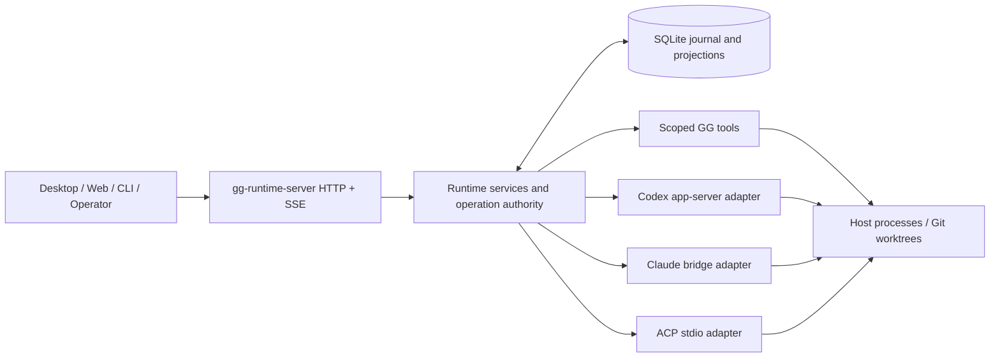
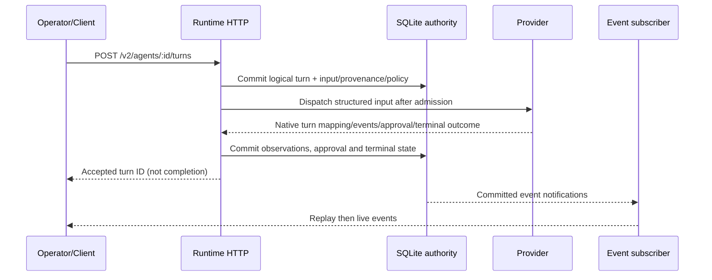

Gooselake is a host-side control plane for agent work. Its core boundary is between **clients and the runtime**, not between clients and provider SDKs. A desktop UI, web console, script or CLI sends commands over HTTP, then renders durable records and event replay. SQLite and runtime services remain the source of truth when the client disconnects.



## Composition root

`crates/runtime-server/src/bootstrap.rs` composes configuration, local secrets, SQLite migrations, provider adapters, the session manager, workspace/message/worktree services, process scheduling, tool gateway, recovery, and Axum HTTP routes. Provider startup is optional and configuration-dependent; operator workspace and migration inspection does not depend on live model execution.

Repository responsibilities:

| Location | Authority or adapter |
| --- | --- |
| `crates/runtime-core` | Workspace/agent identity, durable operations, turns, approvals, provider contracts, agent messages, lifecycle and recovery |
| `crates/runtime-store-sqlite` | Ordered migrations, transactional authority, indexed status, journal and query/replay implementation |
| `crates/runtime-server` | Bootstrap, auth, operator/scoped HTTP routes, SSE, generated OpenAPI |
| `crates/runtime-provider-codex` | Persistent app-server, structured input, approvals, native GG tools and provider evidence |
| `crates/runtime-provider-claude` | Claude bridge policy, sessions, native approval/context behavior and scoped MCP injection |
| `crates/runtime-provider-acp` | Configured external ACP stdio agent, negotiated capabilities and durable permission handoff |
| `crates/runtime-tools` | Worktree management, managed process scheduling, GG tool semantics |
| `sidecars/claude-bridge` | Isolated Claude SDK/bridge execution |
| `sidecars/gg-mcp-server` | Scoped tool transport for Claude and ACP |

## Workspace-first data model

A **workspace** is keyed by the canonical filesystem root and records its lifecycle, revision, optional lead and repository identity. Every normal `/v2` public agent is created **within one workspace**; its active roster is that workspace's team, not an independent `TeamRecord`. The agent's opaque `sess_*` ID remains stable across restarts and archive/restore, alongside immutable ownership, friendly alias, title provenance, exact recreation policy and optional verified managed-worktree route.

Leadership is nullable and revision-checked. A lead must be an active member of the same workspace. Removing a lead leaves the workspace leadless unless an operator explicitly assigns another. An archived agent is not automatically re-promoted on restore.

A deterministic generation-1 migration classifies legacy sessions, teams and worktrees into mapped or **unresolved** authority without guessing ownership. Legacy `TeamRecord`/`TeamMessageRecord` and `/v1` routes remain readable during the migration window, but are not the canonical final write authority for new workspace coordination.

## Durable operations and provider effects

Multi-resource mutations have runtime-generated operation IDs, normalized input, principal, claims, phase transitions, effect intents and exact receipts. **Native effects are preceded by durable intent**, not by an optimistic success response. Identity claims prevent a second request from racing an unknown Git/provider outcome.

An operator can replay the same eligible `Idempotency-Key` and normalized request safely; different input conflicts. If a provider call may have crossed a boundary but the receipt is unknown, the effect stays in manual review instead of calling the provider again. Independent provider/session/effect evidence is required for recovery.

Workspace retirement follows this same pattern across agents, active turns, processes, deliveries, worktrees, provider attachments, hooks and notices. A retired workspace is reactivated only when its existing canonical identity and outstanding recovery obligations permit it.

## Admitted logical turns and provider approvals



The public logical turn is runtime-owned; provider-native turn IDs are correlated separately. User-input snapshots preserve text, durable images and optional skill invocation. Model messages, onboarding, process completion, hooks and lifecycle notices are distinct **automation/transport provenance**, not human user text.

Provider-native approval requests and decisions are persisted against an admitted turn. A runtime pre-dispatch approval gate is distinct. Known-not-dispatched input can be retried; ambiguous native dispatch cannot.

## Provider differences are capability-gated

Codex uses a persistent app-server with structured text/image/skill inputs, native dynamic tools and current provider session identity. Claude uses its bridge with exact current recreation/permission/setting-source policy, scoped MCP and provider observations. ACP launches a configured external agent over stdio and negotiates optional lifecycle/input/model behavior. ACP may legitimately manage its own model catalog, skills and private system harness.

Common runtime identity, turns, approvals, process and message semantics do **not** imply every adapter supports image input, native skills, workspace rebinding, manual compaction or hard-fork/edit-and-rerun. Operator `/v2/capabilities` and provider discovery report what is supported, unavailable or agent-managed.

## Three model GG tools and messaging authority

When enabled, the model-facing contract is exactly `gg_team`, `gg_message` and `gg_process`. Codex receives their native dynamic-tool definitions. Claude/ACP receive a per-agent MCP sidecar, which calls the `/v2/mcp` gateway using a **runtime-issued agent-scoped Bearer**, distinct from operator credentials. A trusted invocation header identifies one tool request; the model cannot choose or forge its own caller/workspace/sender in JSON.

`gg_message direct` routes to active agents across workspaces. `broadcast` snapshots recipients only from the authenticated sender's current workspace. Durable agent-first messages own per-recipient delivery rows; the provider receives compact `<agent_msg>` context rather than legacy team bookkeeping. Workspace membership and agent title/role notices use the same durable automation-input layer.

`gg_process run` admits managed work before host spawn; completed processes **push** one owner-model completion input. Scheduler limits, process identities, authoritative log files and safe restart classification are separate from bounded live previews.

## Worktrees and hot projections

Managed worktree identity is tied to the workspace's canonical repository root/common Git directory. Git creation, claims, eligibility and cleanup have durable operation safeguards. Reassigning an existing agent requires a **provider-proven effective cwd/rebind**; changing the SQLite cwd alone cannot finalize it.

High-frequency roster, worktree, context, process, operation and message list APIs use bounded/index-backed projections where implemented. They remain derived from authoritative records, never a second write authority. Context percentages are tied to the current provider attachment and hidden if stale.

## Event journal and streaming

The durable event journal includes `session` (public agent), `workspace`, legacy `team`, `process`, `worktree` and `system` scopes. A row has a global journal ID and a per-scope sequence. Operator `GET /v2/events` is a bounded, redacted **history list**; `GET /v2/events/{event_id}` is full detail. Operator global/workspace/agent/process SSE streams expose `after_seq` and `Last-Event-ID` cursor replay. Agent streams use the canonical `session` scope.

Streams **subscribe to committed SQLite notifications before replay**, catch up with indexed journal reads and do not idle-poll the database every 250 ms. A lagged notification is a wakeup to replay from the last delivered durable cursor, not an alternate event source. The notification bus is in-process, not cross-host replication. See [Events and recovery](/docs/events-and-recovery) for cursor semantics and retained journal limits.

## API, docs and release boundary

Operator `/v2` requires one runtime Bearer header and produces stable error/request IDs. Model `/v2/mcp` uses a distinct per-agent scoped credential; `/v1` operator routes remain transitional. Public `/health` and `/openapi.yaml` require no token.

`crates/runtime-server/src/http/route_table.rs` is the **same declarative route manifest** used by Axum and the OpenAPI operation catalog. Real Rust/serde `JsonSchema` derives supply typed `/v2` bodies, enums, nullability, query bounds, headers and auth metadata. The dynamic MCP gateway result values remain intentionally open-ended. `make api-docs-refresh/status/check` enforces the checked-in OpenAPI/docs relationship.

Replaceable installed assets include:

```text
bin/gg-runtime-server
sidecars/claude-bridge/claude-bridge
sidecars/gg-mcp-server/gg-mcp-server
openapi.yaml
contracts/runtime-contracts.json
contracts/gooselake-harness-v1.md
contracts/codex-model-policy.json
```

SQLite state, configured secrets, provider homes, process logs and managed Git worktrees are **durable host state**, not bundle contents. Release verification compares packaged contract assets with the actual embedded runtime contract, and isolated install/staged upgrade validation rejects corrupted candidates without overwriting the valid installation. These offline checks do not claim authenticated provider or device acceptance.

For executable examples, see [Setup](/docs/setup), [API guide](/docs/api), [Providers](/docs/providers), and [Install](/docs/install).
