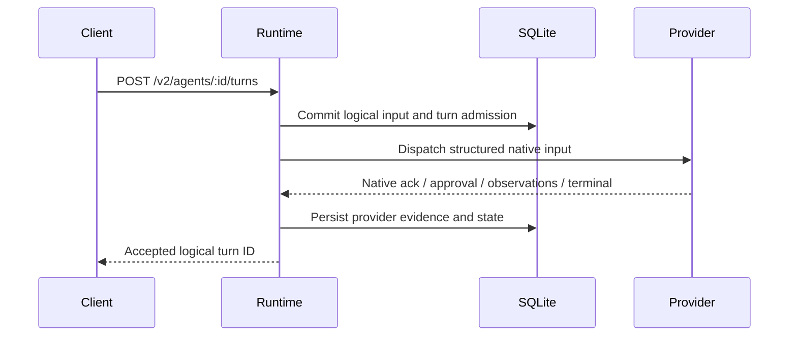

The normal public lifecycle begins with a **workspace**, not a free-floating provider session. A client registers an existing project root, creates an agent inside its active workspace roster, observes mandatory onboarding, and then sends logical turns. The runtime owns every durable identity and decision; the provider is an execution adapter.

## Register the workspace

`POST /v2/workspaces` canonicalizes an existing root and stores the workspace/operation identity transactionally. The same canonical root converges on one workspace ID. A retired root may reactivate that identity after its previous retirement has proven terminal and its outstanding resource obligations allow it.

Workspace leadership is optional. Only a trusted operator may set/clear the lead with revision protection, not a model tool or automatic member election.

## Create a workspace agent

`POST /v2/workspaces/{workspace_id}/agents` specifies provider, optional model and exact recreation preferences, and optional root/managed-worktree selection. The runtime:

1. Validates workspace, provider policy, resource eligibility and the caller's operation identity.
2. Persists the **native creation intent**, frozen launch policy, claims and reserved `sess_*` agent identity before creating a provider session or Git checkout.
3. Performs allowed native/hook effects, recording their evidence without guessing success after a transport error.
4. Transactionally commits the provider-backed session, immutable workspace ownership, friendly alias, active roster profile, approved route, exact recreation policy and mandatory onboarding notice.
5. Returns the stable agent ID and operation receipt. A lost response can be recovered with the same eligible `Idempotency-Key`.

An unknown provider-create outcome remains in `manual_review` with its durable operation coordinate, **not** a silently created agent or a second provider attempt.

## Mandatory onboarding comes before user input

Each new workspace agent receives a deterministic system onboarding notice identifying its alias, workspace and current lead or leadless state, plus approved optional task/image/skill context. Onboarding is recorded as `automation_context` provenance, never a fabricated human prompt.

Onboarding may remain `pending`, `injecting` or `manual_review` until exact provider evidence exists. An ordinary user turn sent ahead of mandatory onboarding can receive `409 onboarding_pending`. Query `GET /v2/workspaces/{workspace_id}/agents/{agent_id}/onboarding`; do not assume creation means the model has already seen its instructions.

## Admit a logical turn before provider work

`POST /v2/agents/{agent_id}/turns` accepts ordered structured input. Before native provider dispatch, the runtime commits:

- a runtime-owned logical turn ID and owning agent
- canonical input, source provenance and optional durable user-input snapshot
- policy/turn preference snapshot, expected-parent/correlation state and dispatch recovery classification
- the session's single active-turn authority

Provider-native turn IDs are mapped separately after actual native evidence. Models and providers cannot substitute their own native IDs for the public runtime ID.

**Accepted means admitted, not finished.** Follow durable records/events until a terminal result; the same agent cannot own two conflicting active normal turns.

## Approvals and preference controls

Provider-native command/file/permission approvals are attached to an **already-admitted** logical turn. Requests, choices and resolution are durable, deduplicated and routed to the exact provider approval reference. They are separate from any optional runtime pre-dispatch approval gate. Do not auto-approve malformed, ambiguous or unrouteable requests.

Supported explicit thinking/permission/compaction controls mutate authoritative policy or create their own durable correlation; unsupported provider controls return capability errors. Codex collaboration mode is turn-scoped rather than a recreated session permission.

## Dispatch uncertainty is not a retry signal

If a provider proves dispatch **did not** occur, a bounded safe retry may be possible. If the call *may* have reached the provider but local acknowledgement is missing, the turn enters reconciliation/recovery instead of replaying the input. A client must inspect its durable operation/turn evidence rather than issue a new request key to “try again.”

This rule applies equally to native agent creation/rebind, workspace retirement, and other external effects.

## Terminal state, interrupts and automatic context

A provider reports terminal `completed`, `failed` or `interrupted` evidence tied to the logical turn. The runtime persists that outcome, releases active-turn authority, stores usage/context observations if current, and appends events; duplicate agreeing observations converge.

Direct/broadcast message deliveries, managed-process completion, onboarding, membership/worktree notices and hook results are separate **automation/transport** inputs. Process termination and completion delivery are different durable facts: completion is pushed into the owner agent's context exactly once, including after restart, not polled by the model.

An operator can interrupt an active agent or a workspace roster. Idle/non-interruptible members are reported as skipped rather than inventing turns for them.

## Resume, archive and retirement

Resume/recreation uses the **current authoritative** provider/model/tool/permission/setting-source/harness policy and preserves the same public agent ID. Provider-native attachment identity and current revision fence stale context observations and rebind evidence.

Archiving makes an agent non-routable but preserves its history; restoring it does not restore former leadership. Workspace retirement is an operation across native attachments, active turns, processes, deliveries, worktrees and notices. It is not equivalent to a bare flag update; unresolved native effects need evidence-based review before declaring it complete.

## Legacy and client boundaries

`/v1/sessions` and independent `/v1/teams` still exist for migration compatibility, but the canonical normal workflow is workspace-owned `/v2` agents. An unresolved generation-1 session stays a classified migration subject rather than becoming a guessed workspace member.

For complete route fields, see [API guide](/docs/api). For event cursors and crash recovery, see [Events and recovery](/docs/events-and-recovery).
